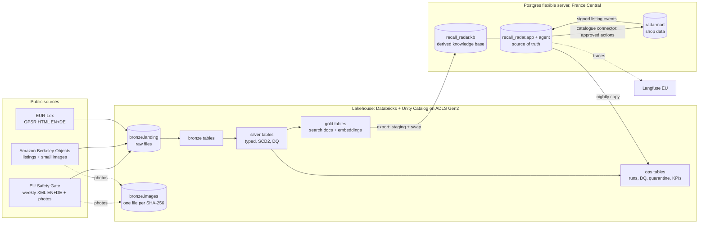
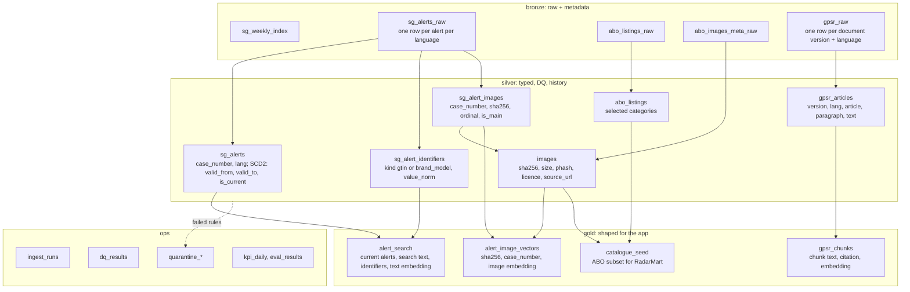
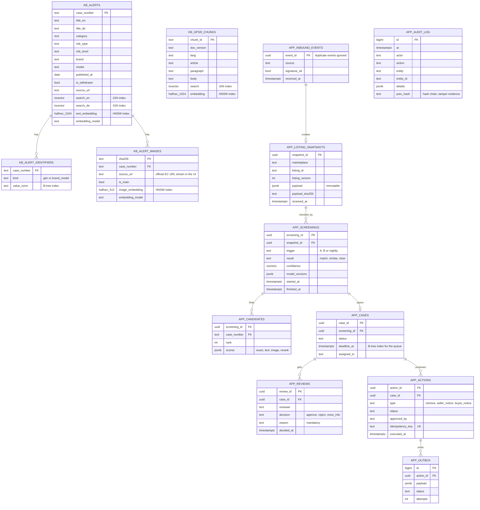
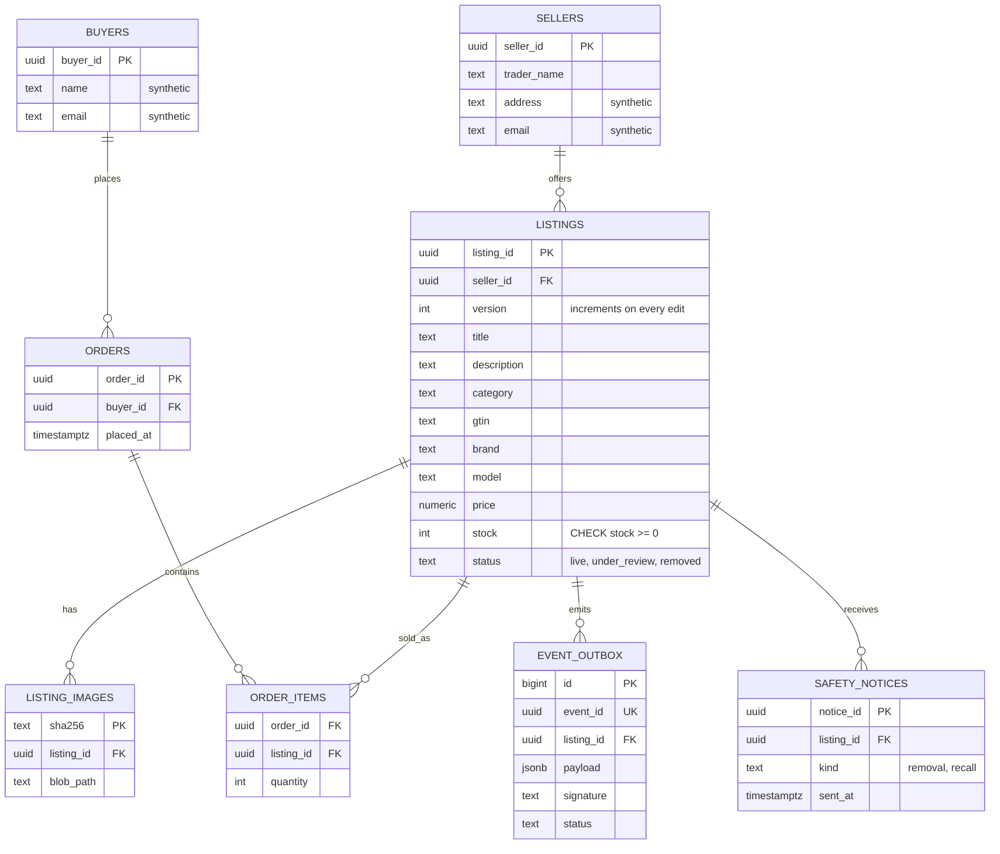
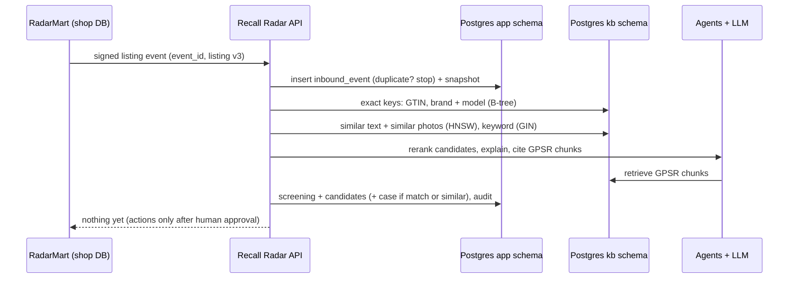

# Recall Radar: data and storage design

- Status: Accepted (Product Owner, 2026-11-13)
- Date: 2026-11-13
- Decision record: [ADR-0004](../adr/0004-data-storage.md)
- Inputs: [design brief](../design-brief.md), [data sources](../data/data-sources.md),
  [PRD](../product/product-requirements.md), [PD-001](../product/decisions/PD-001-two-trigger-screening.md),
  [PD-002](../product/decisions/PD-002-radarmart.md), [ADR-0003](../adr/0003-infrastructure-layout.md)
- Editable diagrams (draw.io): [`storage-landscape.drawio`](../diagrams/storage-landscape.drawio),
  [`medallion-tables.drawio`](../diagrams/medallion-tables.drawio), [`postgres-erd.drawio`](../diagrams/postgres-erd.drawio).
  The Mermaid diagrams below show the same content and render directly on GitHub.

This document decides **where every piece of data lives, who owns it, and how it moves**. It follows
a five-step method: entities and access patterns → classify → non-functional needs → simplest store that
fits → data flows. Decisions are made **per entity**, not once for the whole system.

## 1. Summary of decisions

| # | Decision | Why |
|---|----------|-----|
| D1 | **Lakehouse (Databricks + Unity Catalog on ADLS) is the source of truth for ingested public data**: Safety Gate, ABO, GPSR | History, data quality, reprocessing; analytics never run on the app database |
| D2 | **Postgres (one server) serves the application**: the knowledge base is a derived copy of gold; cases, reviews, actions and the audit log are owned here | One database for app data, vectors and full-text (design-brief constraint) |
| D3 | **Vectors as `halfvec`, one text vector per alert**; fewer old photos only if needed; recall measured on the gold set | Keeps vectors at ~0.7 GB, inside the 2 GiB RAM of the B1ms server |
| D4 | **Safety Gate photos: private copy in the lake**, stored once per SHA-256, never served publicly; the UI shows the official EC image URL | Re-embedding and reproducible evals without re-downloading; licence risk controlled |
| D5 | **RadarMart has its own database on the same server**; it talks to Recall Radar only through signed events and the catalogue connector | Each system owns its data; realistic integration (PD-002); same cost |
| D6 | **Recall Radar stores an immutable snapshot of every listing it checks** | Audit evidence must show the listing as it was at decision time |
| D7 | **Exact keys (GTIN, brand + model) use normal B-tree indexes and run before any AI step** | The catastrophic error "exact match missed" must not depend on vectors |

## 2. Entities and access patterns

| Entity | Main access patterns | Pattern type | Written by | Read by |
|--------|----------------------|--------------|-----------|---------|
| Safety Gate alert | Get by case number; find by GTIN or brand + model; find similar by text; history of updates | Point lookup, exact-key lookup, similarity, history | Ingestion (weekly + hourly check) | Screening, case view, chat |
| Alert photo | Find similar photos; show side by side | Similarity, large-object read | Ingestion | Screening, case view |
| ABO listing + photos | Select subset; seed RadarMart; build safe gold cases | Batch scan | Ingestion (one-off + refresh) | Data team, RadarMart seed, evals |
| GPSR text | Search by article; semantic + keyword search with citation | Point lookup, hybrid search | Ingestion (per consolidation) | Legal RAG, chat |
| RadarMart listing, order, buyer, seller | Checkout, stock, order history, seller edits | Transactions across entities | RadarMart | RadarMart; Recall Radar only via events/connector |
| Listing snapshot | Get the evidence for a case | Point lookup, append-only | Recall Radar (on every check) | Case view, audit |
| Screening, candidate, case, review, action | Review queue by deadline; case by id; approve/reject | Transactions, range scan by deadline | Recall Radar | UI, agents, KPI jobs |
| Audit log | Append; read by case or time | Append-only, range scan | Recall Radar | Auditor, export |
| Agent checkpoints, chat history | Resume a run; load a conversation | Key lookup | Agents, chat | Agents, chat |
| Traces, eval runs | Debug a run; compare versions | Time-range scan | Langfuse SDK, eval jobs | Developers, CI eval gate |
| KPIs (time to decision, false alarms, cost per check) | Aggregate per day | Time-window aggregation | Nightly job | Dashboard |

## 3. Non-functional requirements that shape storage

| Need | Value (design brief) | Storage consequence |
|------|----------------------|---------------------|
| Listing check latency | p95 ≤ 10 s, event → result | Hot data (exact keys, vectors) must be in Postgres memory; no lake reads in the request path |
| Back-scan after new alert | ≤ 5 min for the demo catalogue | Listing vectors in Postgres; batch query, not one call per listing |
| Correctness of decisions | Catastrophic errors listed in the brief | Strong consistency (single Postgres primary, transactions) for cases, reviews, actions |
| Volume | ~1,000 checks/day, ~90 alerts/week, 10–15k listings | Small for the app; the alert history and photos are the big parts |
| Cost | ≤ €30/month total | Free-tier Postgres (B1ms, 2 GiB RAM, 32 GB); no extra managed stores |
| Location and privacy | EU only; synthetic personal data; logs 30 days | All stores in EU regions; buyer data only in RadarMart |
| Licences | Commission reuse with attribution; ABO CC BY 4.0; EUR-Lex with attribution | Licence and source URL stored with every record and image |

## 4. Estimates

Assumptions (written down so they can be changed):
- Safety Gate history since 2005: **up to 100,000 alerts** (about 4,700 per year today; the exact number is counted in US-007).
- **3.3 photos per alert** (measured on 716 alerts in Sprint 0), about **150 KB per photo** (one measured sample).
- Demo catalogue: **15,000 listings**, about **2.7 photos per listing** (ABO has 398,212 images for 147,702 listings).
- Text embeddings with **1,024** dimensions; image embeddings with **512** dimensions (models chosen in F06).
- Vectors stored as `halfvec` (2 bytes per number).

```python
A = 100_000
L = 15_000
rows = [
    ("alert text (1 per alert)", A, 1024),
    ("alert photos (3.3 per alert)", int(A * 3.3), 512),
    ("listing text", L, 1024),
    ("listing photos (2.7 per listing)", int(L * 2.7), 512),
    ("GPSR chunks (EN+DE)", 1200, 1024),
]
tot = 0
for name, count, dims in rows:
    mb = count * dims * 2 / 1e6
    tot += mb
    print(f"{name:32} {count:>8,} x {dims:>4} dims  halfvec {mb:6.0f} MB")
links = sum(c for _, c, _ in rows) * 16 * 2 * 4 / 1e6
print(f"HNSW graph links (m=16, approx)  {links:6.0f} MB")
print(f"TOTAL                            {tot + links:6.0f} MB")
photos = int(A * 3.3)
print(
    "photo files GB",
    round(photos * 0.15 / 1e3, 1),
    "| download hours at 5/s",
    round(photos / 5 / 3600, 1),
)
```

Output (real run):

```text
alert text (1 per alert)          100,000 x 1024 dims  halfvec    205 MB
alert photos (3.3 per alert)      330,000 x  512 dims  halfvec    338 MB
listing text                       15,000 x 1024 dims  halfvec     31 MB
listing photos (2.7 per listing)   40,500 x  512 dims  halfvec     41 MB
GPSR chunks (EN+DE)                 1,200 x 1024 dims  halfvec      2 MB
HNSW graph links (m=16, approx)      62 MB
TOTAL                               680 MB
photo files GB 49.5 | download hours at 5/s 18.3
```

**What the numbers tell us**

- With full precision (4 bytes) and separate EN and DE text vectors, vectors alone would be about **1.6 GB**,
  too much for a server with 2 GiB RAM. `halfvec` + one text vector per alert brings it to **~0.7 GB** (D3).
- The **photos are the biggest data** (~50 GB if the whole history is downloaded) and the **slowest to fetch**
  (~18 hours at a polite 5 requests per second). So photos are loaded **newest years first**, and the history
  depth for photos is a setting, not a code change.
- **Measured on 2026-11-14 (US-011, the 2,000 newest photos):** 197 KB on average (median 157 KB),
  53 % PNG / 47 % JPEG, 2.4 photos per alert (103,619 photo URLs for 42,525 current alerts). The full
  photo history is therefore about **20 GB** and **5.8 hours** at 5 requests per second, not 50 GB / 18 h.
  It is loaded in batches (`max_photos` per run), newest first; each run continues where the last stopped.
- The app tables (cases, reviews, audit) stay in the low megabytes for the demo; they are not a size concern.

## 5. Store per entity

| Data | Source of truth | Derived copies (rebuildable) | Consistency |
|------|-----------------|------------------------------|-------------|
| Safety Gate alerts (all versions) | Lake: `bronze` → `silver.sg_alerts` (SCD2) | `gold.alert_search` → Postgres `kb.alerts` + vectors | Eventual (minutes after ingestion) |
| Alert photos | Lake volume `bronze.images`, one file per SHA-256 | Postgres `kb.alert_images` (embedding only, no bytes) | Eventual |
| ABO listings + photos | Lake (`bronze`, `silver`) | RadarMart seed; eval cases | Batch |
| GPSR text | Lake (`bronze.gpsr_raw`, versioned by consolidation date) | Postgres `kb.gpsr_chunks` | Eventual |
| RadarMart listings, orders, buyers, sellers | Postgres database `radarmart` | Listing events → Recall Radar snapshots | Strong inside RadarMart |
| Listing snapshots, screenings, cases, reviews, actions, audit | Postgres database `recall_radar`, schema `app` | Lake `ops` copies for KPIs and evals | **Strong** |
| Agent checkpoints, chat history | Postgres `recall_radar`, schema `agent` | — | Strong |
| Traces | Langfuse (EU region), 30 days | — | Eventual |
| Eval datasets | Git (`evals/data/`, versioned) | Lake `ops.eval_*` results | — |

**What we deliberately do not add:**
- **No Redis in the cloud.** It's in the local dev compose only. A managed cache would cost a large part of the
  budget; rate limits and caches start in Postgres and move to Redis only if measurements demand it.
- **No search engine (OpenSearch/AI Search).** Postgres full-text (German and English configurations) plus
  pgvector covers hybrid search at our scale.
- **No vector database.** See D3.

### 5.1 Landscape



## 6. Lakehouse design

### 6.1 Layout

| Place | Content | Rule |
|-------|---------|------|
| `rr_<env>.bronze.landing` (volume) | Raw files exactly as downloaded | Never edited; file name includes a content hash, so the same content is stored once |
| `rr_<env>.bronze.images` (volume) | Photos, path `sha256/ab/cd/<sha256>.<ext>` | One file per content hash (US-011); private, no public URL |
| `rr_<env>.bronze.*` | One table per source, raw fields + metadata columns | Append-only; unknown fields kept in `_rescued_data` |
| `rr_<env>.silver.*` | Typed, cleaned, de-duplicated; history (SCD2) | Data-quality rules; failures go to quarantine |
| `rr_<env>.gold.*` | Shaped for the app: search documents, chunks, embeddings with model version | Exported to Postgres |
| `rr_<env>.ops.*` | Ingestion runs, DQ results, quarantine, KPIs, eval results | Operational, not product data |

Landing paths:

```text
/Volumes/rr_dev/bronze/landing/
  safety_gate/index/fetched_date=2026-11-13/weekly_index_<sha12>.xml
  safety_gate/reports/lang=en/Report-2026-44_<sha12>.xml
  safety_gate/reports/lang=de/Report-2026-44_<sha12>.xml
  abo/listings/listings_0_<sha12>.json.gz
  abo/images_meta/images_<sha12>.csv.gz
  gpsr/lang=en/CELEX_32023R0988_consolidated-2026-05-29_<sha12>.html
  gpsr/lang=de/CELEX_32023R0988_consolidated-2026-05-29_<sha12>.html
```

Why the hash in the file name: if a source publishes **changed** content under the same name, it lands as a
**new** file (new hash) and is ingested; the **same** content downloaded twice has the same name and is skipped.
That gives "every report captured exactly once" (US-007) without extra bookkeeping.

### 6.2 Tables per layer



Columns every bronze table has (US-007):

| Column | Meaning |
|--------|---------|
| `_source_file` | Path of the landing file the row came from |
| `_ingested_at` | When the row was written |
| `_batch_id` | ID of the ingestion run (joins to `ops.ingest_runs`) |
| `_rescued_data` | Fields the schema did not expect, kept instead of dropped |
| `_source_url`, `_licence` | Where it came from and under which licence |

Silver rules (US-010, US-011):

| Rule | Where | On failure |
|------|-------|-----------|
| `case_number` present and in one of the 10 measured formats (HTML tags and a trailing dot are repaired) | `sg_alerts` | Quarantine row |
| GTIN check digit valid (8, 12, 13 or 14 digits) | `sg_alert_identifiers`, ABO | Quarantine the identifier, keep the alert |
| Publication date present, `dd-MM-yyyy`, not in the future | `sg_alerts` | Quarantine |
| Risk level is one of the 3 known labels (EN/DE) | `sg_alerts` | Keep the alert as `unknown`, count in `ops.dq_results` |
| Image decodes, size > 0, allowed type | `images` | Quarantine the image, keep the alert |
| Update or withdrawal of an alert | `sg_alerts` | Not an error: close the old version (`valid_to`), open a new one (SCD2) |

Normalisation for exact keys (in silver, so the app does no guessing):
`gtin` = digits only, zero-padded to 14; `brand_norm` and `model_norm` = lower case, accents removed,
spaces and punctuation removed, ASCII only. Examples: `"EP-TA200"` → `"epta200"`,
`" Samsung "` → `"samsung"`, GTIN `"4 006381 333931"` → `"04006381333931"`.

How US-010 implements this (evidence: `docs/data/profiles/sg-alerts-bronze-2026-11-14.md`):

- **Rules as code:** `packages/transform` (`rr_transform`), pure Python, unit-tested in CI; the notebook
  `pipelines/silver/sg_alerts_silver.py` calls them in a Spark UDF.
- **Full rebuild:** silver = rules(bronze) on every run, written with atomic `overwrite`. Right while
  bronze is small (~96k rows, about a minute). Switch to an incremental `MERGE` when bronze passes
  ~10 million rows or the run takes longer than ~15 minutes.
- **One table per language version:** `sg_alerts` is keyed by `(case_number, lang)`. The EC sends one
  complete record per language, so a separate `sg_alert_texts` table would need two histories kept in
  sync; it was dropped. Gold takes texts per language and identifiers from either.
- **Version order:** report year, report week, file (the file stored first is the original, later files
  are corrections), position in the report. Identical consecutive contents (`row_hash`) collapse.
- **`valid_from`:** the publication date for the original file; the time the correction was stored for
  later files. **Withdrawal:** a case listed in an older file of a report but not in its newest file.
- **Pictures:** `sg_alerts.picture_urls` (first = main photo); `sg_alert_images` is filled by US-011.
- **File order must be known:** original vs correction is decided by the time each file was stored in the
  landing volume. A bulk upload gives files the same time, so silver **stops** when two files of one report
  share a time instead of guessing (found on 2026-11-14: a bulk upload had reversed one pair).
- **Reports change after publication:** on 2026-11-14 the EC served new files for Reports 2026-21 to 2026-26;
  of 505 re-delivered alerts per language only 10 had changed and became new versions, the rest collapsed.
  `valid_from` of a correction is therefore when we stored it, not when the EC changed it, and the download
  must run every week.

### 6.3 Embeddings

Embeddings are computed in **gold**, in batch, and stored with `model_name` and `model_version`.
Changing the model means: compute a new gold version, export it to new Postgres tables, run the eval gate,
then switch. The photos are already in the lake (D4), so re-embedding needs no new downloads.

## 7. Postgres design

### 7.1 Databases and schemas (one server)

| Database | Schema | Owner | Content |
|----------|--------|-------|---------|
| `recall_radar` | `kb` | Export job (read-only for the app) | Alerts, identifiers, alert image vectors, GPSR chunks |
| `recall_radar` | `app` | Recall Radar API | Snapshots, screenings, candidates, cases, reviews, actions, outbox, audit, users |
| `recall_radar` | `agent` | LangGraph library | Checkpoints, chat history |
| `radarmart` | `shop` | RadarMart | Sellers, buyers, listings, images, orders, event outbox |

Each database has its own login role. The Recall Radar role **has no access** to `radarmart`, and the other way
round. The `kb` schema is written only by the export role.

### 7.2 Recall Radar tables



Index choices:

| Query | Index | Why |
|-------|-------|-----|
| Exact GTIN / brand + model | B-tree on `kb_alert_identifiers(value_norm)` | Microseconds; catastrophic error class (D7) |
| Similar text | HNSW on `halfvec(1024)`, cosine | Approximate search in memory |
| Similar photo | HNSW on `halfvec(512)`, cosine | Same |
| Keyword (names, codes) | GIN on `tsvector` with `german` and `english` configurations | Hybrid search: model numbers and brands are matched exactly |
| Review queue | B-tree on `cases(status, deadline_at)` | Oldest deadline first |

### 7.3 RadarMart tables



RadarMart writes the listing change **and** the event into `event_outbox` in the **same transaction**
(outbox pattern), and a sender delivers it. So a listing can never change without an event, and an event can
never exist for a change that was rolled back. Recall Radar ignores duplicate `event_id`s.

### 7.4 Gold → Postgres export (US-012)

1. Load gold into `kb_staging.*` tables (same structure).
2. Build the indexes on staging (HNSW build is the slow part; it happens off the live tables).
3. Check row counts against gold and run the schema contract tests.
4. In **one transaction**, rename `kb` → `kb_old` and `kb_staging` → `kb`; then drop `kb_old`.

Readers see either the complete old version or the complete new one, never a half-loaded state.

## 8. Main data flows

### 8.1 Trigger A: new or changed listing



Rough latency budget (to be measured in F06 and F10):

| Step | Estimate |
|------|----------|
| Verify signature, write event and snapshot | < 0.1 s |
| Exact-key lookup | < 0.01 s |
| Embed listing text and main photo | 0.5–2 s |
| Vector and keyword searches (in memory) | < 0.2 s |
| Rerank + explanation with citations (LLM) | 2–5 s |
| **Total** | **~3–7 s**, inside p95 ≤ 10 s |

The LLM step dominates. Storage is not on the critical path, **as long as the indexes stay in memory** (D3).

### 8.2 Approved buyer recall notice

1. The reviewer approves the action → `app.actions` (status `approved`) + `app.audit_log`, in one transaction,
   with an `idempotency_key`.
2. The outbox sender calls the catalogue connector: "notify buyers of listing X".
3. RadarMart finds the buyers in its own orders and sends the notice. **Recall Radar never stores buyer
   e-mail addresses**, so the "wrong recipients" error is prevented by design.

### 8.3 Weekly and hourly ingestion

1. Downloader writes new files into `landing` (hash in the name).
2. Bronze job (Auto Loader) picks up only new files and adds the metadata columns.
3. Silver job applies DQ rules and SCD2; failures go to `ops.quarantine_*`; counts go to `ops.dq_results`.
4. Image job downloads photos of new alerts (newest first), stores them by SHA-256, records them in `silver.images`.
5. Gold job builds search documents and embeddings for changed alerts.
6. Export job refreshes `kb` (staging + swap).
7. New alerts start **Trigger B** (back-scan of the catalogue).

## 9. Consistency per entity

| Entity | Consistency | During a network problem | Why |
|--------|-------------|--------------------------|-----|
| Reviews, actions, audit | Strong (one primary, transactions) | Fail rather than diverge | Decisions and external effects must be exact |
| Cases, screenings | Strong | Fail and retry | Same |
| Knowledge base (`kb`) | Eventual, minutes behind the lake | Serve the last complete version | A new alert being minutes late is acceptable; a half-loaded table is not (swap) |
| Listing data in Recall Radar | Eventual, seconds behind RadarMart | Events wait in the RadarMart outbox | The snapshot fixes what was checked |
| KPIs, eval results | Eventual (nightly) | Recompute | Reporting only |

## 10. Security, privacy, licences

| Topic | Design |
|-------|--------|
| Personal data | Only synthetic buyers and sellers, only in `radarmart`. Recall Radar stores seller name inside snapshots (needed for evidence), never buyer data |
| Access | One login role per database and purpose (`rr_app`, `rr_export`, `radarmart_app`); least privilege; no superuser in apps |
| Lake access | Unity Catalog grants; storage reachable only through the access connector identity |
| Photos (D4) | Private volume, no public link; UI shows the official EC URL; licence + source URL stored per image; deletion on request removes the file, the row and the vector |
| GDPR deletion (demo) | Delete in RadarMart → event → Recall Radar removes the person from snapshots it holds (seller only); lake copies use row-level deletes; Langfuse traces expire after 30 days |
| Logs | Redaction from F01; no secrets or e-mail addresses in logs |

## 11. Backups and recovery

| Store | Backup | RPO / RTO (demo) | Rebuild path |
|-------|--------|------------------|--------------|
| Postgres `app`, `agent`, `radarmart` | Azure automated backups, 7 days, point-in-time restore | Minutes / ~1 hour | Restore test once before release (F17) |
| Postgres `kb` | Not needed | — | Re-export from gold (derived) |
| Lake tables | Delta time travel; storage soft delete | Hours / hours | Re-run pipelines from `landing` |
| Landing files and photos | Storage soft delete | — | Re-download from public sources (slow for photos) |

## 12. Evolution path and triggers

| Trigger (measured) | Next step |
|--------------------|-----------|
| Vector recall@20 drops below 0.90 with `halfvec` | Full precision for text only, or rerank with full-precision vectors from the lake |
| Postgres memory pressure (cache hit ratio < 99 %, p95 search > 200 ms) | Fewer old photo vectors (D3 reserve lever), then a bigger server |
| Real marketplace catalogue with millions of listings | Partition listing vectors by category; consider a dedicated vector or search service |
| Many marketplaces (tenants) | `tenant_id` on every app table and row-level security |
| Cache needs (repeated LLM calls) | Exact cache in Postgres first; Redis only if measured |

## 13. Risks and open points

| Risk | Mitigation | Owner / when |
|------|-----------|--------------|
| Real alert count differs from 100k | Count in US-007; recompute section 4 | US-007 |
| Photo download is slow (~18 h for full history) | Newest years first; history depth is a setting | US-011 |
| `halfvec` or single-language vectors lower recall | Measured on gold set (cross-language and image-only cases) before acceptance | F06 |
| Photo licence | Private copy only, attribution, deletion process; revisit if the Commission states different terms | ADR-0004 |
| Shared server: RadarMart load slows screening | Demo scale; monitor; separate servers only if measured | F17 |
| Databricks compute cost | Jobs on demand, small clusters, auto-termination; cost per run recorded in `ops.ingest_runs` | F03 |
