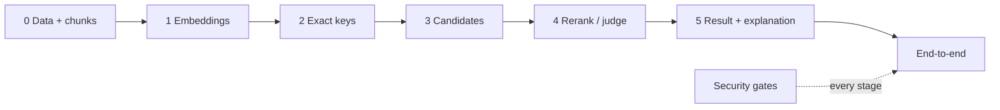

# Evaluation gates: every stage is measured

Rule (PO, 16 Nov 2026, [ADR-0005](../adr/0005-ai-architecture.md)): **every stage of every AI workload has
its own metric, dataset and threshold.** A later stage cannot fix an earlier one: if retrieval does not
find the right alert, no reranker or LLM can produce a good result. So each stage passes its gate before we
build or tune the stage after it.

## Gates per stage

Thresholds come from the design brief. "tracked" means the metric is reported, and a drop of more than
the tolerance against the stored baseline on `main` fails the gate.

### W1 Screening

| # | Stage | What can go wrong | Metric | Dataset / slice | Gate |
|---|-------|-------------------|--------|-----------------|------|
| 0 | Data and documents | Alerts missing, empty text, wrong language, broken identifiers | Coverage of current alerts; empty-text rate; DQ checks | Gold export checks | 100 % coverage; 0 empty search texts; all DQ checks pass |
| 1 | Embeddings | Model does not understand German, cross-language, photos | Recall@50 of the embedding alone (text, photo) | Matching dev set; slices: EN, DE, cross-language, image-only | Recorded per slice; chosen model is best on recall@50 without a slice < 0.80 |
| 2 | Exact keys | A GTIN or brand + model match is missed | Recall on exact-key cases | `exact_key` slice | **100 %** (hard) |
| 3 | Candidates (hybrid + photo, RRF) | Right alert not among the candidates | Recall@20, recall@50, MRR | All matching cases + slices | Recall@20 ≥ 0.90 overall and ≥ 0.85 per slice |
| 4 | Rerank / judge | Right alert ranked low; safe look-alike called a match | Precision@5, nDCG@10; judge accuracy vs labels | Cases that pass the cascade threshold | Precision@5 ≥ 0.80 |
| 4a | Cascade threshold | A dangerous listing marked "clear" without a judge call | Recall of dangerous cases above the threshold | Dangerous cases | ≥ 0.98 |
| 5 | Result | Wrong match / similar / clear | Catch rate, false-alarm rate | Test split | ≥ 90 % / ≤ 5 % |
| 5a | Explanation | Evidence or field comparison not true | Claims supported by listing/alert fields (code check + judge) | Sample of 30 | ≥ 0.95 |
| E2E | Latency and cost | Too slow or too expensive | p95 check time; € per 1,000 checks | Replay of the test split | p95 ≤ 10 s; within budget |

### W2 Assistant

| # | Stage | Metric | Gate |
|---|-------|--------|------|
| 0 | GPSR chunks | Every article and paragraph present; citation fields filled; current version marked | 100 % |
| 1 | Planner / router | Route accuracy; filter exact match; language | ≥ 95 % |
| 2 | Legal retrieval | Context recall; recall@10 of expected chunks | ≥ 0.90 |
| 3 | Answer | Faithfulness; key-fact correctness | ≥ 0.95; tracked |
| 4 | Citations | Citation correctness; every article number and deadline found in the cited text (code) | ≥ 95 %; **0** invented deadlines |
| 5 | Abstention | Correct "not found" on `should_abstain` cases; false refusals | tracked; false answers ≤ 5 % |

### W3 Case workflow (Sprint 4)

| # | Stage | Metric | Gate |
|---|-------|--------|------|
| 1 | Tool choice | Tool-call accuracy and argument accuracy | ≥ 95 % |
| 2 | Task | Task success checked in code (final state), pass^3 | ≥ 80 %; tracked |
| 3 | Approval | Approval requested for every action, never skipped | 100 % |
| 4 | Safety | Unapproved action, wrong recipient, data outside role | **0** (hard) |

## Security gates (run with every stage)

| Gate | Metric | Threshold |
|------|--------|-----------|
| Injection in listing text (adversarial set) | Result or ranking changed by injected instructions | **0** on critical cases |
| Exact-key override | LLM changes a deterministic match | **0** |
| Legal citation integrity | Invented article or deadline | **0** |
| Role and data access | Answer, tool result or log with data outside the user's role | **0** |
| Leakage | System prompt, secrets or personal data in output or traces | **0** |
| False refusals | Benign questions refused | ≤ 5 % |

Threats and controls: [threat model](../security/threat-model.md).

## How it runs

| When | What runs |
|------|-----------|
| Every PR touching `packages/retrieval`, `packages/rag`, `packages/agents`, prompts or `evals/` | Unit tests of the harness; small dev sample of the affected stages; security gates on the attack sample |
| Nightly (Test) | All stages, full dev set, all security cases |
| Before a model, prompt, chunking or embedding change is merged | Full gates for the changed stage **and every stage after it** |
| Release | Test split (once), holdout untouched until the final report |

## Rules

1. **Gates live in `evals/gates.yaml`** (stage, metric, slice, threshold, hard/soft); the harness reads them.
   Changing a threshold needs a PR and a reason.
2. **First failing stage:** for every wrong result, the report names the first stage that failed. The
   distribution shows where to work next.
3. **Report per slice**, never only the average (language, cross-language, image-only, exact-key, category).
4. **Dev for tuning, test for decisions, holdout for the final report.** Gold sets are never used in prompts.
5. **LLM judges are calibrated** on ~50 hand-labelled examples before use (agreement recorded), with narrow
   yes/no questions and an evidence quote that code checks.
6. Every run records dataset version, model versions, prompt version and commit in `evals/reports/`.
